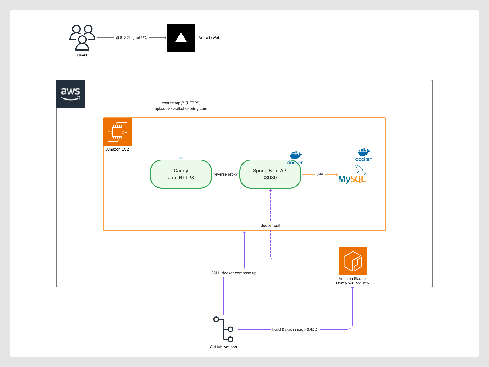

<div align="center">

# 🚄 KORAIL SERVER

**PLAY SOPT 39기 합동 세미나 · 모바일 웹 1조**
코레일 승차권 예매 서비스 서버


</div>

<br>

## 👥 Team

|  |  |  |
|:---:|:---:|:---:|
| [조효림](https://github.com/hyorim-jo) (Lead) | [남궁린](https://github.com/namgunglin413) | [윤해민](https://github.com/hamtorygoals) |
| 호차 목록 · 좌석 배치 조회<br>서버 초기 세팅 · CI/CD | 열차 목록 조회<br>열차 상세 · 운임 조회 | 승차권 예약 생성 · 조회 |

<br>

## 🔗 Links

| | |
|---|---|
| 🌐 Web Repository | [39-COLLABORATION-WEB-KORAIL](https://github.com/SOPT-all/39-COLLABORATION-WEB-KORAIL) |
| 🗂 ERD | [ERDCloud](https://www.erdcloud.com/d/44XY9ZNki9MsoKKX6) |
| 📄 API Docs | [Swagger UI](https://api.sopt-korail.chokoring.com/swagger-ui/index.html) |

<br>

## 🏗 Architecture



- `main`에 머지되면 GitHub Actions가 Docker 이미지를 빌드해 ECR에 올립니다. (IAM Role + OIDC 인증)
- EC2에 SSH로 접속해 새 이미지를 받고 `docker compose`로 재시작합니다.
- Caddy가 HTTPS 인증서를 자동 발급하고, 요청을 Spring Boot 컨테이너로 전달합니다.

<br>

## 🛠 Tech Stack

| 분류 | 기술 |
|---|---|
| Language | Java 17 |
| Framework | Spring Boot 4, Spring Web MVC |
| Database | MySQL 8.0, Spring Data JPA, QueryDSL |
| API Docs | springdoc-openapi (Swagger UI) |
| Test | JUnit 5, Mockito, AssertJ, ArchUnit, H2 |
| CI | GitHub Actions (PR 테스트 + JaCoCo 커버리지 리포트) |

<br>

## 📡 API

📄 **API 명세: [Swagger UI](https://api.sopt-korail.chokoring.com/swagger-ui/index.html)**
(로컬: `http://localhost:8080/swagger-ui/index.html`)

### 공통 응답 형식

```json
{
  "isSuccess": true,
  "code": "SEAT2001",
  "message": "호차 목록 조회에 성공했습니다.",
  "result": { }
}
```

<br>

## 📁 Project Structure

```
src/main/java/org/sopt/korail
├── global          # 공통 응답·코드, 예외 처리, 설정, Swagger
├── member          # 회원
├── schedule        # 열차, 역, 운행 일정, 운임
├── seat            # 호차, 좌석
└── reservation     # 예약, 승차권
```

> 도메인 내부 패키지 구조는 [main 코드 컨벤션](docs/MAIN_CONVENTION.md#1-패키지-구조)을 참고하세요.

<br>

## 🚀 Getting Started

```bash
# 1. 환경 변수 설정
cp dev/.env.example dev/.env    # MYSQL_ROOT_PASSWORD, CORS_ALLOWED_ORIGINS 입력

# 2. MySQL 실행
docker compose --env-file dev/.env -f dev/docker-compose.dev.yml up -d

# 3. 서버 실행
./gradlew bootRun

# 테스트
./gradlew test
```

> ⚠️ 서버를 실행할 때마다 테이블을 새로 만들고 `data.sql`로 초기 데이터를 넣습니다. 재시작하면 기존 데이터는 초기화됩니다.

<br>

## 🤝 Convention

### 문서
- 📘 [main 코드 컨벤션](docs/MAIN_CONVENTION.md)
- 🤖 [테스트 코드 작성 지침 (AI용)](docs/AI_TEST_GUIDE.md)

### Git Flow

```
main ← develop ← feat/#이슈번호-기능
```

- 이슈를 먼저 만들고, 이슈 번호로 브랜치를 만듭니다. (`feat/#5-coach-list`)
- `develop`으로 PR을 올리고, CI(테스트)를 통과하면 머지합니다.

### Commit

```
타입: 작업 내용 (#이슈번호)
```

| 타입 | 설명 |
|---|---|
| `feat` | 새로운 기능 |
| `fix` | 버그 수정 |
| `refactor` | 동작 변경 없는 코드 개선 |
| `test` | 테스트 추가·수정 |
| `docs` | 문서 수정 |
| `chore` | 빌드, 설정, 의존성 변경 |

예) `feat: 좌석 배치 조회 API 구현 (#6)`
